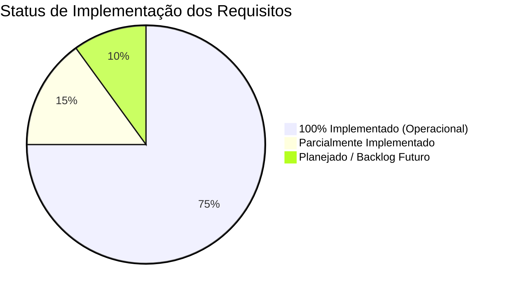
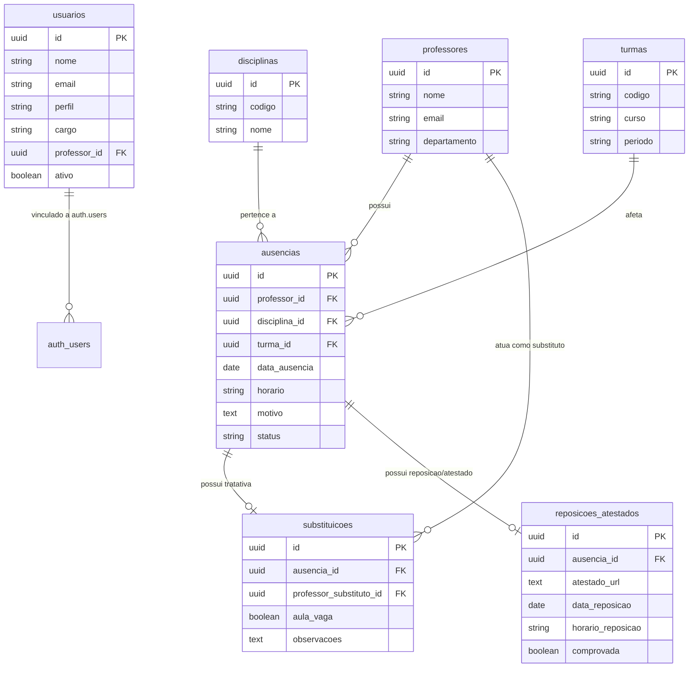

# 📌 Project State — Docente360
**Última atualização:** 17 de Outubro de 2026  
**Status do Projeto:** Fase 1 Concluída (MVP Operacional e Funcional) — ~85% dos Requisitos Principais Atendidos

---

## 1. Visão Geral do Sistema

O **Docente360** é uma plataforma web integrada concebida para modernizar, agilizar e centralizar a gestão de ausências docentes, substituições em sala de aula, controle de atestados médicos e homologação pedagógica de reposições de aulas.

O projeto substitui controles manuais e planilhas descentralizadas por um fluxo de trabalho estruturado com controle de acesso baseado em papéis (**RBAC**), integrado ao **Supabase** (Auth, PostgreSQL e Storage) e com interface reativa desenvolvida em **Streamlit**.

---

## 2. Stack Tecnológica Implementada

| Camada | Tecnologia / Biblioteca | Função no Projeto |
| :--- | :--- | :--- |
| **Frontend & UI** | [Streamlit](https://streamlit.io/) (v1.30+) | Interface interativa, formulários operacionais, componentes visuais e controle de sessão. |
| **Backend / BaaS** | [Supabase](https://supabase.com/) (PostgreSQL 15+) | Banco de dados relacional com integridade referencial, triggers e segurança RLS. |
| **Autenticação & RBAC** | Supabase Auth Oficial | Gerenciamento de credenciais seguras, sessões e metadados de perfis de usuário. |
| **Armazenamento de Arquivos** | Supabase Storage (`atestados`) | Bucket para upload seguro de atestados médicos e comprovantes (PDF/PNG/JPG). |
| **Visualização de Dados** | [Plotly](https://plotly.com/) (v5.18+) | Gráficos interativos (distribuição por status em rosca e faltas por docente). |
| **Processamento de Dados** | [Pandas](https://pandas.pydata.org/) (v2.0+) | Manipulação tabular, joins e agregações em memória. |
| **Geração de Documentos** | [ReportLab](https://www.reportlab.com/) (v4.0+) | Geração sob demanda de relatórios oficiais em formato PDF estilizado. |

---

## 3. Resumo Executivo do que Já Foi Realizado



### Principais Marcos Concluídos:
1. **Banco de Dados Modelado e Estruturado:** Criação das tabelas relacionais com chaves estrangeiras, triggers de sincronização e seeds para testes imediatos.
2. **Autenticação Oficial com Supabase Auth & Perfis:** Sistema completo de Login e Cadastro de operadores com segregação de telas por perfil (Secretaria, Coordenador Acadêmico e Administrador).
3. **Módulo Operacional da Secretaria (100% Funcional):**
   - Lançamento rápido de ausências com vinculação de docente, turma, disciplina, horário e motivo.
   - Painel de tratativas de pendências para alocação de docente substituto ou declaração formal de "Aula Vaga".
   - Formulário de upload de atestados para o Supabase Storage e registro da proposta de reposição.
   - Histórico tabular completo de ocorrências.
4. **Módulo Pedagógico da Coordenação Acadêmica (100% Funcional):**
   - Dashboard analítico em tempo real com 5 KPIs e gráficos interativos (Plotly).
   - Fluxo de homologação pedagógica de reposições com consulta direta ao anexo do atestado.
   - Exportação de relatórios oficiais em PDF institucional via ReportLab e planilhas em CSV.
5. **Módulo de Administração:** Painel de consulta de usuários cadastrados e visão geral operacional.
6. **Arquitetura Modular em Camadas:** O código monolítico de `app.py` foi decomposto em camadas dedicadas (`services/`, `views/`, `components/`, `utils/`), tornando o sistema extensível e manutenível.

---

## 4. Matriz de Rastreabilidade de Requisitos

Abaixo está o detalhamento de cada requisito levantado no documento [`levantamento_requisitos.md`](file:///d:/Projects/docente360/levantamento_requisitos.md) confrontado com a implementação atual nos módulos do sistema:

### 4.1. Perfis de Usuário e Autenticação (RBAC)

| Perfil | Requisito Planejado | Situação Atual | Onde está no Código |
| :--- | :--- | :---: | :--- |
| **Autenticação Geral** | Login e registro com Supabase Auth oficial, senhas criptografadas e persistência de sessão. | ✅ **Concluído** | [`services/auth_service.py`](file:///d:/Projects/docente360/services/auth_service.py) e [`views/login.py`](file:///d:/Projects/docente360/views/login.py) |
| **Tabela de Usuários** | Sincronização entre `auth.users` e tabela de perfis de usuário com RLS. | ✅ **Concluído** | [`banco_dados.sql:65-119`](file:///d:/Projects/docente360/banco_dados.sql#L65-L119) |
| **Secretaria** | Acesso restrito a operações diárias de ausências, substituições e atestados. | ✅ **Concluído** | [`views/secretaria.py`](file:///c:/Users/2503097/Documents/Docente360/views/secretaria.py) |
| **Coordenador Acadêmico** | Acesso restrito a dashboards, homologações pedagógicas e exportação de relatórios. | ✅ **Concluído** | [`views/coordenador.py`](file:///c:/Users/2503097/Documents/Docente360/views/coordenador.py) |
| **Professor** | Portal do Docente para envio de atestados, reposições, auto-aviso de faltas e vínculo a cadastros existentes. | ✅ **Concluído** | [`views/professor.py`](file:///c:/Users/2503097/Documents/Docente360/views/professor.py) e [`views/login.py`](file:///c:/Users/2503097/Documents/Docente360/views/login.py) |
| **Administrador** | Gestão de contas, cadastros base e visão global com alternador master entre todos os setores. | ✅ **Concluído** | [`views/admin.py`](file:///c:/Users/2503097/Documents/Docente360/views/admin.py) e [`components/styles.py`](file:///c:/Users/2503097/Documents/Docente360/components/styles.py) |

---

### 4.2. Requisitos Funcionais (RF)

| Código | Requisito | Status | O que já conseguimos fazer / Observações |
| :---: | :--- | :---: | :--- |
| **RF01** | **Lançamento Diário de Ausências** | ✅ **Concluído** | Formulário dinâmico em [`views/secretaria.py`](file:///d:/Projects/docente360/views/secretaria.py). Salva data, horário/bloco, motivo categorizado e observações livres com status inicial `"Pendente"`. |
| **RF02** | **Gestão de Substituições e Aulas Vagas** | ✅ **Concluído** | Painel reativo em [`views/secretaria.py`](file:///d:/Projects/docente360/views/secretaria.py). Permite selecionar entre alocar docente substituto ou classificar como `"Aula Vaga"` com justificativa para a turma. |
| **RF03** | **Controle de Atestados e Comprovações** | ✅ **Concluído** | Upload de arquivos nos formatos `.pdf`, `.png`, `.jpg`, `.jpeg` com persistência direta no Supabase Storage (`bucket: atestados`) via [`views/secretaria.py`](file:///d:/Projects/docente360/views/secretaria.py). |
| **RF04** | **Planejamento e Acompanhamento de Reposição de Aulas** | ✅ **Concluído** | Secretaria pré-agenda reposição em [`views/secretaria.py`](file:///d:/Projects/docente360/views/secretaria.py) e o Coordenador avalia, homologa ou recusa em [`views/coordenador.py`](file:///d:/Projects/docente360/views/coordenador.py). |
| **RF05** | **Dashboard de Indicadores em Tempo Real** | ✅ **Concluído** | Painel analítico em [`views/coordenador.py`](file:///d:/Projects/docente360/views/coordenador.py) com 5 métricas em cards + 2 gráficos interativos Plotly. |
| **RF06** | **Exportação de Relatórios Gerenciais** | ✅ **Concluído (Avançado)** | Central de relatórios na Coordenação em [`views/coordenador.py`](file:///d:/Projects/docente360/views/coordenador.py) com filtros reativos (período, docente, turma, status), pré-visualização tabular e emissão em **PDF Oficial Diagramado (Paisagem)** via [`utils/pdf_generator.py`](file:///d:/Projects/docente360/utils/pdf_generator.py) com NumberedCanvas, sumário de KPIs, cabeçalho e assinaturas institucionais, além de exportação em planilha **CSV**. |

---

### 4.3. Regras de Negócio (RN)

| Código | Regra de Negócio | Status | Situação Atual |
| :---: | :--- | :---: | :--- |
| **RN01** | **Conflito de Horário do Substituto** | 🔄 **Parcial** | O sistema já impede alocar o próprio docente ausente como seu próprio substituto. *Falta checagem de choque de agenda com outras turmas no mesmo horário.* |
| **RN02** | **Prazo de Envio de Atestado (48h)** | ⏳ **Pendente** | O registro de atestado funciona normalmente, mas ainda não exibe badge visual de alerta para atestados atrasados além de 48h úteis. |
| **RN03** | **Homologação Obrigatória de Reposição** | ✅ **Concluído** | Reposições só transitam para o status `"Reposta"` e `comprovada = true` após ação explícita do Coordenador Acadêmico no painel. |
| **RN04** | **Classificação de Pendência / Alerta** | ✅ **Concluído** | Ausências não tratadas são mantidas com status `"Pendente"` e listadas com destaque prioritário na aba de substituições da secretaria. |
| **RN05** | **Sigilo de Dados Sensíveis (LGPD)** | ✅ **Concluído** | Comprovantes médicos são restritos e visíveis unicamente nos fluxos operacionais autorizados (Secretaria e Homologação da Coordenação). |

---

### 4.4. Requisitos Não Funcionais (RNF)

| Código | Requisito | Status | Implementação |
| :---: | :--- | :---: | :--- |
| **RNF01** | **Usabilidade e Frontend** | ✅ **Concluído** | Desenvolvido em Streamlit com estilos centralizados em [`components/styles.py`](file:///d:/Projects/docente360/components/styles.py). |
| **RNF02** | **Banco de Dados Relacional** | ✅ **Concluído** | PostgreSQL estruturado no Supabase com integridade referencial (`ON DELETE CASCADE` e `SET NULL`). |
| **RNF03** | **Armazenamento Seguro de Arquivos** | ✅ **Concluído** | Utilização da API de Storage do Supabase (`bucket: atestados`). |
| **RNF04** | **Eficiência Operacional (<60s)** | ✅ **Concluído** | Formulários de preenchimento rápido em um clique com atualização imediata via `st.rerun()`. |
| **RNF05** | **Desempenho** | ✅ **Concluído** | Consultas leves em [`services/supabase_service.py`](file:///d:/Projects/docente360/services/supabase_service.py), geração de PDF diretamente em memória (`BytesIO`) e gráficos Plotly renderizados no cliente. |
| **RNF06** | **Segurança e Autenticação** | ✅ **Concluído** | Supabase Auth integrado com metadados do usuário e sincronização via trigger SQL no PostgreSQL. |

---

## 5. Estrutura de Arquivos Modularizada

```plaintext
d:\Projects\docente360\
│
├── app.py                       # Ponto de entrada enxuto (~50 linhas): roteamento RBAC e inicialização
├── banco_dados.sql              # DDL das tabelas, triggers, RLS e dados de seed
├── levantamento_requisitos.md   # Especificação formal de requisitos (RFs, RNs e RNFs)
├── requirements.txt             # Dependências do projeto (Streamlit, Supabase, Pandas, Plotly, ReportLab)
├── PROJECT_STATE.md             # Documento de acompanhamento do estado do projeto
│
├── services/                    # Camada de Serviços e Integrações
│   ├── __init__.py
│   ├── supabase_service.py      # Conexão e queries ao banco PostgreSQL (professores, turmas, ausências, etc.)
│   └── auth_service.py          # Autenticação (Supabase Auth), sessões e controle de perfil
│
├── views/                       # Camada de Apresentação / Telas por Setor
│   ├── __init__.py
│   ├── login.py                 # Tela de Login e Criação de Conta
│   ├── secretaria.py            # Painel da Secretaria (Lançamento, Substituição, Atestados, Histórico)
│   ├── coordenador.py           # Painel da Coordenação (Dashboard, Homologação e Relatórios)
│   └── admin.py                 # Painel do Administrador (Gestão de Usuários e Métricas Globais)
│
├── components/                  # Componentes Visuais Reutilizáveis
│   ├── __init__.py
│   └── styles.py                # Estilização CSS personalizada, cabeçalho e card lateral de usuário
│
└── utils/                       # Utilitários e Geradores
    ├── __init__.py
    └── pdf_generator.py         # Geração de relatórios gerenciais oficiais em PDF com ReportLab
```

---

## 6. Modelagem de Dados Implementada (`banco_dados.sql`)

O banco de dados relacional conta com 7 entidades principais:



---

## 7. Próximos Passos e Backlog Prioritário

1. **Gestão de Cadastros Base na Secretaria e Administrador:**
   - ✅ **Concluído:** Adicionada aba `"📚 Cadastros (Professores & Matérias)"` na Secretaria e visão sincronizada no Administrador com busca em tempo real, validações de duplicidade e exclusão segura com proteção de chaves estrangeiras.
2. **Portal do Docente & Auto-atendimento do Professor:**
   - ✅ **Concluído:** Adicionado perfil `"Professor"`, integração automática com a tabela `professores` via `professor_id`, upload direto de atestados médicos pelo próprio docente, fluxo de auto-comunicação de faltas e visualização de convocações de substituição em [`views/professor.py`](file:///c:/Users/2503097/Documents/Docente360/views/professor.py).
3. **Validação de Conflitos de Agenda (RN01):**
   - Implementar verificação automática se o docente substituto selecionado já possui outra aula ou substituição confirmada no mesmo dia e bloco de horários.
4. **Filtros Temporais Avançados no Dashboard da Coordenação:**
   - Adicionar seletores de intervalo de datas (semana, mês, semestre) e filtros por curso/turma para refinar os gráficos e o relatório em PDF.
5. **Alerta de Prazo de Atestado (RN02):**
   - Destacar em vermelho ausências com mais de 48 horas úteis sem justificativa ou atestado anexado.
