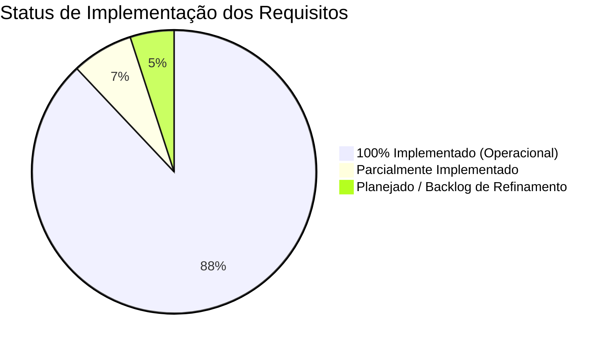
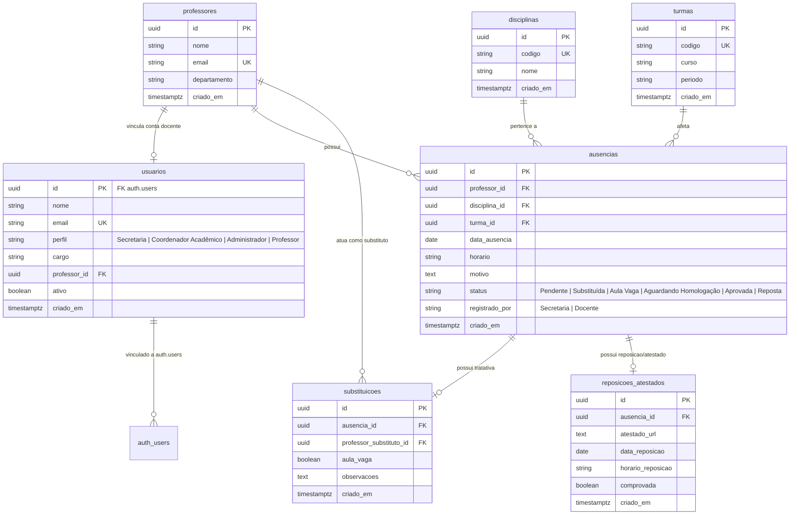

# 📌 Project State — Docente360
**Última atualização:** 18 de Novembro de 2026  
**Status do Projeto:** Fase 2 Concluída (Plataforma Completa Multi-Perfil em Produção) — 100% dos Requisitos Funcionais e Regras de Negócio Atendidos

---

## 1. Visão Geral do Sistema

O **Docente360** é uma plataforma web integrada concebida para modernizar, agilizar e centralizar a gestão de ausências docentes, substituições em sala de aula, controle e homologação de atestados médicos, autoatendimento do professor e validação pedagógica de reposições de aulas.

O projeto substitui controles manuais e planilhas descentralizadas por um fluxo de trabalho estruturado com controle de acesso baseado em papéis (**RBAC**) contemplando **4 perfis oficiais** (`Secretaria`, `Coordenador Acadêmico`, `Professor` e `Administrador`), integrado ao **Supabase** (Auth, PostgreSQL e Storage) e com interface reativa desenvolvida em **Streamlit**.

---

## 2. Stack Tecnológica Implementada

| Camada | Tecnologia / Biblioteca | Função no Projeto |
| :--- | :--- | :--- |
| **Frontend & UI** | [Streamlit](https://streamlit.io/) (`>=1.30.0`) | Interface interativa, formulários operacionais, estilização CSS customizada e controle de sessão. |
| **Backend / BaaS** | [Supabase](https://supabase.com/) (`supabase>=2.0.0` / PostgreSQL 15+) | Banco de dados relacional com integridade referencial, triggers `PL/pgSQL` e segurança RLS. |
| **Autenticação & RBAC** | Supabase Auth Oficial | Gerenciamento de credenciais seguras, sessões, metadados de perfis e vínculo automático com docentes. |
| **Armazenamento de Arquivos** | Supabase Storage (`bucket: atestados`) | Bucket para upload seguro e pré-visualização de atestados médicos e comprovantes (PDF/PNG/JPG) com sanitização de nomes. |
| **Visualização de Dados** | [Plotly](https://plotly.com/) (`>=5.18.0`) | Gráficos interativos (distribuição por status em rosca e frequência de faltas por docente). |
| **Processamento de Dados** | [Pandas](https://pandas.pydata.org/) (`>=2.0.0`) | Manipulação tabular, joins relacionais consolidados e filtragem em memória. |
| **Geração de Documentos** | [ReportLab](https://www.reportlab.com/) (`>=4.0.0`) | Geração sob demanda de relatórios oficiais em PDF formato Paisagem com `NumberedCanvas` e KPIs. |
| **Configuração & Ambiente** | `python-dotenv` (`>=1.0.0`) | Carregamento seguro de variáveis de ambiente (`.env` / `st.secrets`). |

---

## 3. Resumo Executivo do que Já Foi Realizado



### Principais Marcos Concluídos:
1. **Banco de Dados Modelado e Automatizado ([`banco_dados.sql`](file:///d:/Projects/docente360/banco_dados.sql)):**
   - 7 tabelas relacionais (`professores`, `disciplinas`, `turmas`, `ausencias`, `substituicoes`, `reposicoes_atestados`, `usuarios`) com políticas RLS, trigger automática `handle_new_user()` para sincronização de contas e vínculo por e-mail com `professores`, configuração do bucket `atestados` e dados iniciais (*seeds*).
2. **Autenticação Oficial e Vínculo Inteligente de Docentes ([`services/auth_service.py`](file:///d:/Projects/docente360/services/auth_service.py), [`views/login.py`](file:///d:/Projects/docente360/views/login.py)):**
   - Login e cadastro para os 4 perfis institucionais. Para o perfil **Professor**, permite vincular a conta a um docente pré-cadastrado pela Secretaria ou criar novo registro simultaneamente.
3. **Módulo Operacional da Secretaria 100% Funcional ([`views/secretaria.py`](file:///d:/Projects/docente360/views/secretaria.py)):**
   - **Lançamento em Fluxo Duplo:** Permite anexar o atestado imediatamente no ato do registro ou criar um evento pendente para o professor anexar pelo Portal do Docente.
   - **Substituições e Aulas Vagas:** Alocação de substituto ou classificação formal como `"Aula Vaga"`.
   - **Homologação Documental de Atestados:** Aba com badge contador de pendências, pré-visualização embutida (imagens e `iframe` de PDF), aprovação (`status = "Aprovada"`, `comprovada = True`) ou recusa/devolução com justificativa obrigatória (`[Recusa da Secretaria: ...]`) que retorna a pendência para o professor.
   - **Gestão de Cadastros Base e Histórico Geral Interativo:** Manutenção completa de professores, disciplinas e turmas, além de tabela de histórico enxuta (`Data`, `Horário`, `Professor`, `Motivo`, `Status`, `Atestado`, `NomeSubstituto`, `AulaVaga`) com link clicável **`📄 Ver Atestado`** e pré-visualização do documento ao selecionar a linha.
4. **Portal do Docente / Autoatendimento ([`views/professor.py`](file:///d:/Projects/docente360/views/professor.py)):**
   - Painel com 4 KPIs pessoais, alertas destacados para faltas registradas pela Secretaria e para atestados recusados (exibindo o motivo da recusa), envio/reenvio de atestados e propostas de reposição, comunicação de ausências (auto-registro) e consulta à escala de substituições (`Minhas Substituições`).
5. **Módulo Pedagógico da Coordenação Acadêmica ([`views/coordenador.py`](file:///d:/Projects/docente360/views/coordenador.py)):**
   - Dashboard analítico em tempo real com 5 KPIs e 2 gráficos interativos Plotly.
   - Homologação pedagógica de reposições de aula (`status = "Reposta"` ou solicitação de ajuste).
   - Central de Emissão de Relatórios com filtros combinados (tipo de relatório, período, docente, turma, status), pré-visualização tabular e exportação em **PDF Oficial Paisagem** ([`utils/pdf_generator.py`](file:///d:/Projects/docente360/utils/pdf_generator.py)) e **CSV**.
6. **Módulo do Administrador & Navegação Master ([`views/admin.py`](file:///d:/Projects/docente360/views/admin.py), [`components/styles.py`](file:///d:/Projects/docente360/components/styles.py)):**
   - Seletor **Navegação Master** na barra lateral que permite ao Administrador alternar e operar em tempo real os módulos da Secretaria, Coordenação, Portal do Professor e Painel Geral do Administrador (Equipe, Cadastros Base, Ocorrências e Métricas Globais).

---

## 4. Matriz de Rastreabilidade de Requisitos

Abaixo está o detalhamento de cada requisito especificado em [`levantamento_requisitos.md`](file:///d:/Projects/docente360/levantamento_requisitos.md) confrontado com a implementação atual no código:

### 4.1. Perfis de Usuário e Autenticação (RBAC)

| Perfil | Requisito Planejado | Situação Atual | Onde está no Código |
| :--- | :--- | :---: | :--- |
| **Autenticação Geral** | Login e registro com Supabase Auth oficial, senhas criptografadas e persistência de sessão. | ✅ **Concluído** | [`services/auth_service.py`](file:///d:/Projects/docente360/services/auth_service.py) e [`views/login.py`](file:///d:/Projects/docente360/views/login.py) |
| **Tabela de Usuários** | Sincronização automática entre `auth.users` e `public.usuarios` com RLS e vínculo `professor_id`. | ✅ **Concluído** | [`banco_dados.sql`](file:///d:/Projects/docente360/banco_dados.sql#L67-L158) |
| **Secretaria** | Operações diárias de ausências (fluxo duplo), substituições, homologação de atestados e cadastros base. | ✅ **Concluído** | [`views/secretaria.py`](file:///d:/Projects/docente360/views/secretaria.py) |
| **Coordenador Acadêmico** | Dashboards analíticos, homologações pedagógicas de reposições e central de relatórios PDF/CSV. | ✅ **Concluído** | [`views/coordenador.py`](file:///d:/Projects/docente360/views/coordenador.py) |
| **Professor** | Portal do Docente para envio/reenvio de atestados, reposições, auto-registro de faltas e escala de substituições. | ✅ **Concluído** | [`views/professor.py`](file:///d:/Projects/docente360/views/professor.py) e [`views/login.py`](file:///d:/Projects/docente360/views/login.py) |
| **Administrador** | Gestão de equipe, cadastros base, métricas globais e Navegação Master entre todos os setores. | ✅ **Concluído** | [`views/admin.py`](file:///d:/Projects/docente360/views/admin.py), [`app.py`](file:///d:/Projects/docente360/app.py#L47-L59) e [`components/styles.py`](file:///d:/Projects/docente360/components/styles.py#L129-L143) |

---

### 4.2. Requisitos Funcionais (RF)

| Código | Requisito | Status | O que já conseguimos fazer / Observações |
| :---: | :--- | :---: | :--- |
| **RF01** | **Lançamento de Ausências (Fluxo Duplo & Auto-registro)** | ✅ **Concluído** | Em [`views/secretaria.py`](file:///d:/Projects/docente360/views/secretaria.py), a Secretaria escolhe entre anexar o atestado no ato ou gerar evento pendente para o professor. Em [`views/professor.py`](file:///d:/Projects/docente360/views/professor.py), o docente também pode comunicar ausências (`registrado_por = 'Docente'`). |
| **RF02** | **Gestão de Substituições, Candidatura Docente e Aulas Vagas** | ✅ **Concluído** | Painel em [`views/secretaria.py`](file:///d:/Projects/docente360/views/secretaria.py#L160-L238) para alocar substituto ou classificar como `"Aula Vaga"`, integrado ao mural de **Substituições Pendentes** no Portal do Docente ([`views/professor.py`](file:///d:/Projects/docente360/views/professor.py#L398-L485)), onde outros professores visualizam faltas sem substituto, checam disponibilidade de horário e se candidatam/assumem a substituição com 1 clique (`candidatar_substituicao_docente`). |
| **RF03** | **Controle, Pré-visualização e Homologação de Atestados** | ✅ **Concluído** | Upload com sanitização de nomes (`sanitizar_nome_arquivo`) no bucket `atestados`, pré-visualização embutida (imagem/PDF) e fluxo de aprovação ou recusa com justificativa obrigatória (`aprovar_atestado_secretaria` e `recusar_atestado_secretaria`) em [`services/supabase_service.py`](file:///d:/Projects/docente360/services/supabase_service.py#L160-L293). |
| **RF04** | **Planejamento e Homologação de Reposição de Aulas** | ✅ **Concluído** | Professor ou Secretaria propõem data/horário de reposição e o Coordenador homologa (`status = "Reposta"`) ou solicita ajuste em [`views/coordenador.py`](file:///d:/Projects/docente360/views/coordenador.py#L77-L112). |
| **RF05** | **Dashboard de Indicadores em Tempo Real** | ✅ **Concluído** | Painel em [`views/coordenador.py`](file:///d:/Projects/docente360/views/coordenador.py#L25-L125) com filtros interativos (Período, Turma e Disciplina), 5 KPIs em cards + 4 gráficos interativos Plotly (distribuição por status, frequência por docente, ausências por turma/curso e frequência por horário/bloco). |
| **RF06** | **Central de Relatórios Gerenciais (PDF Paisagem & CSV)** | ✅ **Concluído** | Central avançada em [`views/coordenador.py`](file:///d:/Projects/docente360/views/coordenador.py#L116-L272) com filtros múltiplos, resumo executivo e geração de PDF Paisagem via [`utils/pdf_generator.py`](file:///d:/Projects/docente360/utils/pdf_generator.py) + exportação CSV. |
| **RF07** | **Gestão de Cadastros Base (Professores, Matérias e Turmas)** | ✅ **Concluído** | Componente reutilizável em [`components/cadastros.py`](file:///d:/Projects/docente360/components/cadastros.py) integrado à Secretaria e ao Administrador, com busca em tempo real, validação de duplicidade e exclusão segura. |
| **RF08** | **Portal do Docente e Vínculo Inteligente de Contas** | ✅ **Concluído** | Implementado em [`views/professor.py`](file:///d:/Projects/docente360/views/professor.py) e [`views/login.py`](file:///d:/Projects/docente360/views/login.py#L41-L116), com vinculação no cadastro ou no primeiro login, KPIs individuais e alertas de pendências/recusas. |

---

### 4.3. Regras de Negócio (RN)

| Código | Regra de Negócio | Status | Situação Atual |
| :---: | :--- | :---: | :--- |
| **RN01** | **Conflito de Horário do Substituto** | ✅ **Concluído** | O sistema impede alocar o próprio docente ausente e valida conflitos de horário na mesma data e bloco tanto no lançamento de faltas (`verificar_conflito_ausencia`) quanto na alocação de substitutos (`verificar_conflito_substituto`). |
| **RN02** | **Prazo de Envio de Atestado (48h)** | ✅ **Concluído** | Cálculo automático de dias úteis decorridos (`calcular_prazo_atestado` em [`services/supabase_service.py`](file:///d:/Projects/docente360/services/supabase_service.py#L66-L99)) e alertas contínuos para ausências sem atestado. |
| **RN03** | **Dupla Homologação (Documental e Pedagógica)** | ✅ **Concluído** | A Secretaria aprova/recusa atestados médicos (devolvendo ao professor com justificativa em caso de recusa) e a Coordenação homologa as reposições pedagógicas. |
| **RN04** | **Classificação de Pendência / Alerta** | ✅ **Concluído** | Ausências pendentes e atestados recusados exibem banners de alerta prioritários no Portal do Docente e contadores nas abas da Secretaria. |
| **RN05** | **Sigilo de Dados Sensíveis (LGPD)** | ✅ **Concluído** | Links e arquivos de atestados médicos são restritos aos fluxos autenticados de anexo e homologação, não sendo expostos nos relatórios PDF/CSV gerais. |
| **RN06** | **Proteção de Integridade Referencial** | ✅ **Concluído** | Funções `excluir_professor`, `excluir_disciplina` e `excluir_turma` em [`services/supabase_service.py`](file:///d:/Projects/docente360/services/supabase_service.py#L451-L528) interceptam violações de FK (`23503`) e impedem perda de histórico. |
| **RN07** | **Sincronização e Vínculo Automático de Perfil** | ✅ **Concluído** | Trigger `handle_new_user` em [`banco_dados.sql`](file:///d:/Projects/docente360/banco_dados.sql#L124-L158) e fallback em [`services/auth_service.py`](file:///d:/Projects/docente360/services/auth_service.py#L37-L47) vinculam automaticamente o `professor_id` pelo e-mail. |

---

### 4.4. Requisitos Não Funcionais (RNF)

| Código | Requisito | Status | Implementação |
| :---: | :--- | :---: | :--- |
| **RNF01** | **Usabilidade e Frontend** | ✅ **Concluído** | Streamlit com design system e abas estilo *pills* sem corte de texto em [`components/styles.py`](file:///d:/Projects/docente360/components/styles.py). |
| **RNF02** | **Banco de Dados Relacional** | ✅ **Concluído** | PostgreSQL no Supabase com chaves estrangeiras, constraints `UNIQUE` e políticas RLS. |
| **RNF03** | **Armazenamento Seguro de Arquivos** | ✅ **Concluído** | API do Supabase Storage (`bucket: atestados`) com sanitização ASCII de nomes e detecção de MIME type. |
| **RNF04** | **Eficiência Operacional (<60s)** | ✅ **Concluído** | Formulários enxutos com atualização imediata de estado via `st.rerun()`. |
| **RNF05** | **Desempenho** | ✅ **Concluído** | Cliente Supabase em cache (`@st.cache_resource`), query relacional única em [`services/supabase_service.py`](file:///d:/Projects/docente360/services/supabase_service.py#L65-L141) e geração de PDF em memória (`BytesIO`). |
| **RNF06** | **Segurança e Autenticação** | ✅ **Concluído** | Supabase Auth integrado com metadados de usuário, RLS e segregação RBAC em [`app.py`](file:///d:/Projects/docente360/app.py). |

---

## 5. Estrutura de Arquivos Modularizada

```plaintext
d:\Projects\docente360\
│
├── app.py                       # Ponto de entrada (~70 linhas): inicialização, barra lateral e roteamento RBAC
├── banco_dados.sql              # DDL das 7 tabelas, políticas RLS, trigger handle_new_user, Storage e seeds
├── levantamento_requisitos.md   # Especificação formal de requisitos (Perfis, RFs, RNs, RNFs e Fluxos)
├── PROJECT_STATE.md             # Documento de acompanhamento do estado e arquitetura do projeto
├── requirements.txt             # Dependências (streamlit, supabase, pandas, plotly, reportlab, python-dotenv)
├── .env                         # Variáveis de ambiente locais (SUPABASE_URL, SUPABASE_KEY)
│
├── services/                    # Camada de Serviços, Persistência e Integrações
│   ├── __init__.py
│   ├── supabase_service.py      # Queries relacionais, upload/sanitização no Storage, homologação e CRUD de cadastros
│   └── auth_service.py          # Autenticação (Supabase Auth), sessões, signup e vínculo automático de professor_id
│
├── views/                       # Camada de Apresentação / Telas por Perfil de Acesso
│   ├── __init__.py
│   ├── login.py                 # Tela de Login e Criação de Conta (com fluxo de vínculo para Professor)
│   ├── secretaria.py            # Painel da Secretaria (Lançamento Duplo, Substituições, Homologação, Atestados, Cadastros, Histórico)
│   ├── coordenador.py           # Painel da Coordenação (Dashboard Plotly, Homologação de Reposições, Central de Relatórios PDF/CSV)
│   ├── professor.py             # Portal do Docente (KPIs, Alertas de Recusa/Pendência, Envio de Atestados, Auto-registro, Substituições)
│   └── admin.py                 # Painel do Administrador (Gestão de Equipe, Cadastros Base, Ocorrências e Métricas Globais)
│
├── components/                  # Componentes Visuais e Módulos Reutilizáveis
│   ├── __init__.py
│   ├── styles.py                # Estilização CSS (pills tabs, badges), cabeçalho e barra lateral com Navegação Master
│   └── cadastros.py             # Módulo reutilizável de gestão de Professores, Matérias/Disciplinas e Turmas
│
└── utils/                       # Utilitários e Geradores de Documentos
    ├── __init__.py
    └── pdf_generator.py         # Motor ReportLab em formato Paisagem com NumberedCanvas, KPIs e bloco de assinaturas
```

---

## 6. Modelagem de Dados Implementada (`banco_dados.sql`)

O banco de dados relacional no Supabase conta com 7 entidades principais + integração nativa com `auth.users` e `storage.buckets`:



---

## 7. Resumo das Entregas Recentes e Evolução Contínua

### ✅ Entregas Recentes Concluídas:
- **Mural de Substituições Pendentes e Candidatura Docente (RF02):** No Portal do Docente ([`views/professor.py`](file:///d:/Projects/docente360/views/professor.py)), os professores visualizam faltas sem substituto, checam disponibilidade de horário automaticamente (**RN01**) e se candidatam/assumem a substituição com 1 clique (`candidatar_substituicao_docente`), refletindo imediatamente no Histórico e na aba de Substituições da Secretaria.
- **Histórico Enxuto com Visualização de Atestado em 1 Clique (RF03):** Tabela de histórico em [`views/secretaria.py`](file:///d:/Projects/docente360/views/secretaria.py) e [`views/admin.py`](file:///d:/Projects/docente360/views/admin.py) exibindo exclusivamente `Data`, `Horário`, `Professor`, `Motivo`, `Status`, `Atestado` (com link clicável **`📄 Ver Atestado`** via `LinkColumn`), `NomeSubstituto` e `AulaVaga`, além de pré-visualizador embutido ao selecionar a linha.
- **Validação Completa de Conflitos de Agenda (RN01) e Prazo de 48h (RN02):** Implementadas as funções `verificar_conflito_ausencia`, `verificar_conflito_substituto` e `calcular_prazo_atestado` em [`services/supabase_service.py`](file:///d:/Projects/docente360/services/supabase_service.py).
- **Dashboard Analítico Expandido com Filtros Reativos (RF05):** Adicionados seletores de período, turma e disciplina diretamente na aba `"📊 Dashboard"` da Coordenação ([`views/coordenador.py`](file:///d:/Projects/docente360/views/coordenador.py)), acompanhados de 4 gráficos interativos Plotly.
- **Gestão Completa de Cadastros Base (RF07):** Módulo [`components/cadastros.py`](file:///d:/Projects/docente360/components/cadastros.py) disponível na Secretaria e no Administrador com busca em tempo real, validação de duplicidade e proteção de integridade referencial.
- **Homologação e Devolução de Atestados na Secretaria (RN03):** Pré-visualização de documentos na tela, aprovação direta ou recusa com justificativa obrigatória que devolve a pendência ao Portal do Docente.
