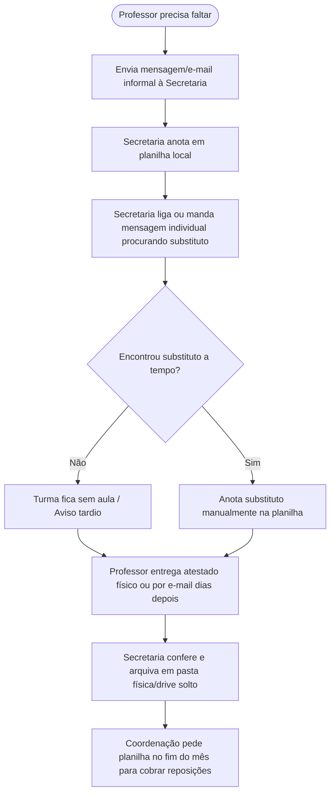
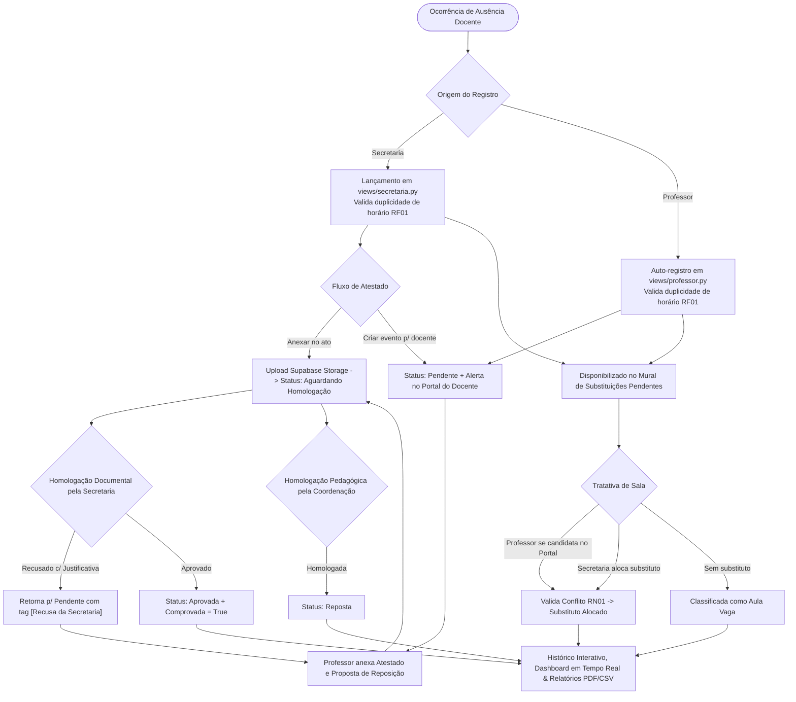

# 🔄 02 — Mapeamento dos Processos Manuais Existentes e Identificação de Pontos Críticos

**Fase:** 01 — Levantamento e Requisitos  
**Tópico:** 02 — Mapeamento de Processos (AS-IS vs. TO-BE) e Gargalos Operacionais  
**Projeto:** Docente360  

---

## 1. Visão Geral do Mapeamento de Processos

A análise comparativa entre o processo manual tradicional (**AS-IS**) e o processo digitalizado pelo **Docente360** (**TO-BE**) permitiu identificar os gargalos exatos que geravam retrabalho, perda de informações e atraso na alocação de professores substitutos.

---

## 2. Processo Manual Tradicional (Cenário *AS-IS*)

No cenário manual típico das instituições de ensino sem sistema dedicado, o fluxo ocorre de forma descentralizada:

### 2.1 Pontos Críticos e Gargalos Identificados no *AS-IS*
1. **Gargalo 1 — Comunicação Assíncrona para Substituição:** A Secretaria perde muito tempo contatando docentes individualmente para descobrir quem está livre naquele bloco de horário, enquanto professores disponíveis não ficam sabendo da oportunidade de substituição.
2. **Gargalo 2 — Risco de Conflito de Horário:** Sem validação automatizada, um docente pode ser escalado para substituir uma turma em um horário no qual já está alocado em outra substituição ou possui ausência registrada.
3. **Gargalo 3 — Falta de Fluxo de Devolução de Atestados:** Quando um atestado enviado por mensagem está ilegível ou incompleto, não há controle formal de pendência para que o professor saiba o motivo da recusa e reenvie o documento.
4. **Gargalo 4 — Retrabalho na Consolidação de Relatórios:** A Coordenação não possui visibilidade instantânea das ocorrências e depende de consolidações manuais sujeitas a erros de digitação.

---

## 3. Processo Digitalizado no Docente360 (Cenário *TO-BE*)

O **Docente360** elimina os controles paralelos ao unificar todos os atores em uma única base transacional no **Supabase**:

---

## 4. Quadro Comparativo de Eficiência (*AS-IS* vs. *TO-BE*)

| Etapa do Processo | Cenário Manual (*AS-IS*) | Cenário Docente360 (*TO-BE*) | Ganho Operacional |
| :--- | :--- | :--- | :--- |
| **Registro da Falta** | 3 a 5 min (mensagem + planilha) | **< 35 segundos** (formulário reativo com validação de conflito) | Redução > 80% no tempo |
| **Busca e Alocação de Substituto** | 15 a 40 min (contatos individuais) | **Instantâneo** (mural de autocandidatura no Portal do Docente + alocação direta) | Autonomia e redução de aulas vagas |
| **Recebimento e Conferência de Atestado** | 5 a 10 min (download manual e arquivamento) | **< 20 segundos** (preview embutido na tela e aprovação/recusa em 1 clique) | Rastreabilidade total e zero extravio |
| **Consulta no Histórico** | Busca manual em pastas e planilhas | **1 clique** no botão `📄 Ver Atestado` ou seleção da linha na tabela enxuta | Acesso imediato ao comprovante |
| **Emissão de Relatório Gerencial** | 1 a 2 horas montando gráficos e PDF | **< 2 segundos** (geração automática em PDF Paisagem e CSV filtrado) | Indicadores em tempo real |

