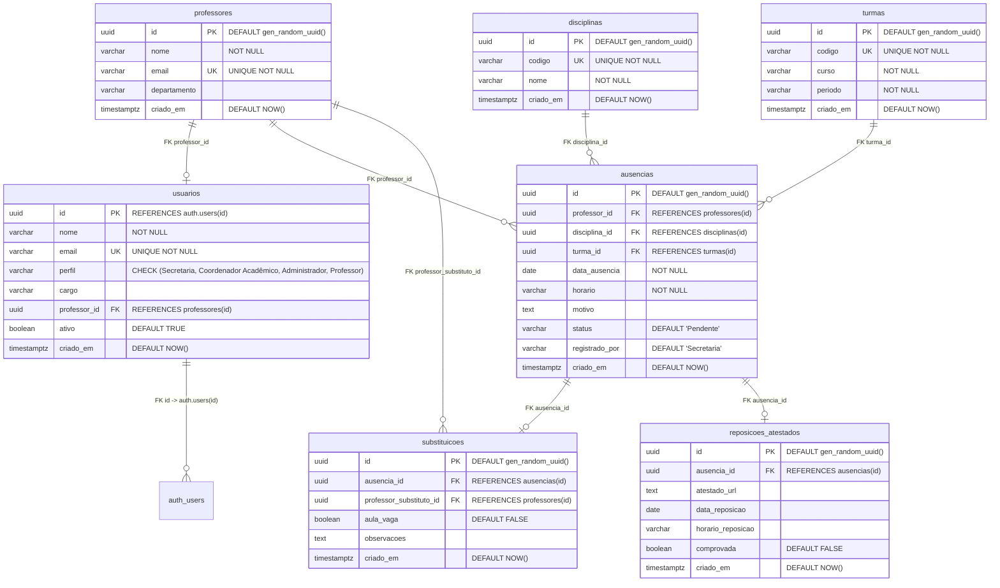

# 🗄️ 01 — Modelagem do Banco de Dados Relacional

**Fase:** 02 — Modelagem e Prototipação  
**Tópico:** 01 — Modelagem de Dados (Professores, Disciplinas, Turmas, Ausências, Substituições, Reposições/Atestados e Usuários)  
**Projeto:** Docente360  

---

## 1. Diagrama Entidade-Relacionamento (DER)

O modelo relacional implementado em [`banco_dados.sql`](file:///d:/Projects/docente360/banco_dados.sql) no **PostgreSQL (Supabase)** estrutura 7 tabelas no esquema `public`, além da integração com `auth.users` e `storage.buckets`:

---

## 2. Dicionário de Dados Detalhado

### 2.1 Tabelas de Cadastro Base
- **`professores`**:
  - `id` (`UUID`, PK): Identificador único do docente.
  - `nome` (`VARCHAR(255)`, NOT NULL): Nome completo do professor.
  - `email` (`VARCHAR(255)`, UNIQUE, NOT NULL): E-mail institucional utilizado para comunicação e vínculo com o login do Portal do Docente.
  - `departamento` (`VARCHAR(100)`): Área acadêmica (ex: *Exatas*, *Humanas*, *Tecnologia & Informática*).
- **`disciplinas`**:
  - `id` (`UUID`, PK), `codigo` (`VARCHAR(50)`, UNIQUE, NOT NULL), `nome` (`VARCHAR(255)`, NOT NULL).
- **`turmas`**:
  - `id` (`UUID`, PK), `codigo` (`VARCHAR(50)`, UNIQUE, NOT NULL), `curso` (`VARCHAR(100)`, NOT NULL), `periodo` (`VARCHAR(50)`, NOT NULL).

### 2.2 Tabelas Operacionais e de Governança
- **`ausencias`**:
  - Armazena cada falta lançada, vinculando `professor_id`, `disciplina_id` e `turma_id`.
  - `status`: Controla o estágio atual (`Pendente`, `Substituída`, `Aula Vaga`, `Aguardando Homologação`, `Aprovada`, `Reposta`).
  - `registrado_por`: Indica se o lançamento partiu da `'Secretaria'` ou do próprio `'Docente'`.
- **`substituicoes`**:
  - Vinculada a `ausencias(id)`. Registra `professor_substituto_id` (alocado pela Secretaria ou por **autocandidatura do professor no Portal do Docente**), flag `aula_vaga` e `observacoes`.
- **`reposicoes_atestados`**:
  - Vinculada a `ausencias(id)`. Armazena `atestado_url` (URL do arquivo no bucket `atestados`), `data_reposicao`, `horario_reposicao` e `comprovada` (`BOOLEAN`).
- **`usuarios`**:
  - Vinculada a `auth.users(id)` e opcionalmente a `professores(id)` via `professor_id`.

---

## 3. Políticas RLS, Trigger e Bucket de Storage

1. **Row Level Security (RLS):** Habilitado em todas as 7 tabelas, garantindo que apenas sessões autenticadas (`TO authenticated`) possam inserir, consultar ou atualizar registros operacionais.
2. **Trigger `on_auth_user_created` (`public.handle_new_user`):** Sincroniza automaticamente todo novo usuário criado no Supabase Auth com `public.usuarios`, buscando e associando o `professor_id` caso o e-mail já exista em `public.professores`.
3. **Bucket `atestados` (`storage.buckets`):** Configurado para receber uploads autenticados de comprovantes médicos (`.pdf`, `.png`, `.jpg`, `.jpeg`) e fornecer URLs para pré-visualização imediata na plataforma.

