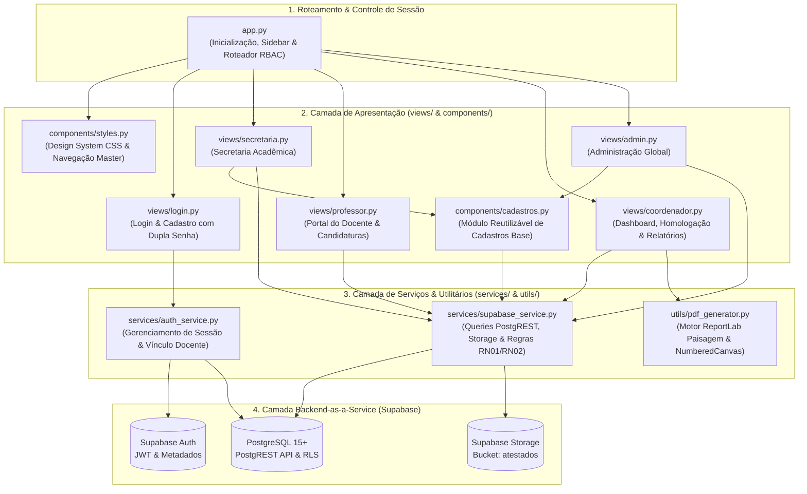

# 🏗️ 02 — Projeto da Arquitetura do Módulo e Integração com o Sistema

**Fase:** 02 — Modelagem e Prototipação  
**Tópico:** 02 — Arquitetura em Camadas e Integração com Supabase (Auth, PostgREST e Storage)  
**Projeto:** Docente360  

---

## 1. Visão Arquitetural em Camadas

O **Docente360** foi estruturado em uma arquitetura modular de **4 camadas locais em Python** integradas a **3 serviços gerenciados em nuvem no Supabase**:



---

## 2. Integração com os Serviços do Ecossistema

### 2.1 Integração de Autenticação e Controle de Acesso (`services/auth_service.py`)
- O cliente Supabase é inicializado como recurso em cache (`@st.cache_resource` em `init_supabase()`), lendo `SUPABASE_URL` e `SUPABASE_KEY` do ambiente (`.env` ou `st.secrets`).
- O login utiliza `supabase.auth.sign_in_with_password()`, carregando os dados complementares da tabela `public.usuarios` em `st.session_state["user_profile"]`.
- O roteador em [`app.py`](file:///d:/Projects/docente360/app.py) direciona cada usuário estritamente ao seu módulo de origem (`Secretaria`, `Coordenador Acadêmico`, `Professor` ou `Administrador`).

### 2.2 Integração de Dados com Joins Relacionais (`services/supabase_service.py`)
- Em vez de realizar múltiplas requisições separadas ao banco para montar as tabelas da interface, a função `get_ausencias_completas()` utiliza a sintaxe de *embedded resources* do **PostgREST** em uma única requisição HTTP:
  ```sql
  id, data_ausencia, horario, motivo, status, registrado_por, professor_id, disciplina_id, turma_id,
  professores!ausencias_professor_id_fkey(id, nome, email),
  disciplinas!ausencias_disciplina_id_fkey(codigo, nome),
  turmas!ausencias_turma_id_fkey(codigo, curso),
  substituicoes(id, aula_vaga, observacoes, professor_substituto_id, professores(nome)),
  reposicoes_atestados(id, atestado_url, data_reposicao, horario_reposicao, comprovada)
  ```
- Os dados retornados são enriquecidos em um `pd.DataFrame` unificado que alimenta simultaneamente o Histórico da Secretaria, o Portal do Docente, o Dashboard Plotly e o Gerador de PDF.

### 2.3 Integração de Arquivos e Visualização Embutida (`Supabase Storage`)
- O upload de atestados médicos passa por `sanitizar_nome_arquivo()` (convertendo caracteres acentuados e espaços para padrão ASCII seguro) e utiliza `supabase.storage.from_("atestados").upload(..., file_options={"upsert": "true", "content-type": mime_type})`.
- A URL pública obtida via `get_public_url()` permite tanto a abertura direta pelo componente `st.column_config.LinkColumn` (`📄 Ver Atestado`) na tabela de Histórico quanto a renderização inline via `<iframe src="...">` e `st.image()`.

