# 🎯 02 — Comparação dos Resultados com os Objetivos e Indicadores Definidos

**Fase:** 06 — Avaliação e Relatório Final  
**Tópico:** 02 — Comparativo entre Metas Planejadas e Resultados Alcançados pelo Docente360  
**Projeto:** Docente360  

---

## 1. Análise Comparativa de Indicadores de Sucesso

A tabela abaixo confronta os objetivos e indicadores definidos na **Fase 1 (Levantamento de Requisitos)** com os resultados efetivamente entregues na conclusão do projeto:

| Indicador / Objetivo Planejado | Meta Inicial (Fase 1) | Resultado Alcançado (Fase 6) | Avaliação Final |
| :--- | :--- | :--- | :---: |
| **Redução do Tempo Operacional da Secretaria (RNF04)** | Redução mínima de **50%** no tempo de registro e controle de faltas (de ~5 min para < 2,5 min). | Redução de **~85%**: lançamento concluído em **24 a 38 segundos** e consulta de atestado em **1 clique** no Histórico. | 🏆 **Meta Superada** |
| **Cobertura dos Requisitos Funcionais Essenciais** | Atender 100% dos 6 requisitos iniciais (RF01 a RF06). | **100% atendidos + 2 novos módulos adicionados** (**RF07** Cadastros Base e **RF08** Portal do Docente com Mural de Candidatura a Substituições). | 🏆 **Meta Superada** |
| **Autonomia para Alocação de Substitutos (RF02)** | Permitir que a Secretaria aloque substitutos sem conflito de horário. | Além da alocação pela Secretaria, foi entregue o **Mural de Substituições Pendentes** onde os próprios professores se candidatam com validação automática (**RN01**). | 🏆 **Meta Superada** |
| **Segurança e Rastreabilidade de Atestados (RF03 / RN03)** | Upload no Supabase Storage e atualização de status. | Upload com sanitização de nomes, preview embutido na tela, aprovação ou **recusa com justificativa devolvendo ao professor** e link clicável `📄 Ver Atestado` no Histórico. | 🏆 **Meta Superada** |
| **Governança Pedagógica e Relatórios (RF05 / RF06)** | Dashboard com KPIs e exportação de relatório em PDF. | Dashboard com filtros reativos, **5 KPIs + 4 gráficos Plotly**, e relatório **PDF Oficial em Paisagem** com `NumberedCanvas` (`Página X de Y`), assinaturas e exportação **CSV**. | 🏆 **Meta Superada** |
| **Segurança no Cadastro de Usuários (RNF06 / RN07)** | Login e cadastro via Supabase Auth com RBAC. | Supabase Auth oficial com **confirmação dupla de senha** (`Senha` e `Confirmar Senha`), vínculo inteligente de professor e **Navegação Master** para o Administrador. | 🏆 **Meta Superada** |

---

## 2. Síntese Qualitativa dos Ganhos

```mermaid
xychart-beta
    title "Tempo Médio gasto por Tarefa: Processo Manual (seg) vs. Docente360 (seg)"
    x-axis ["Registrar Falta", "Alocar Substituto", "Validar Atestado", "Buscar no Histórico", "Gerar Relatório PDF"]
    y-axis "Tempo em Segundos (menor é melhor)" 0 --> 600
    bar [300, 600, 240, 180, 600]
    bar [28, 15, 18, 3, 2]
```

O comparativo comprova que o **Docente360** elimina os principais gargalos operacionais da gestão acadêmica, transformando tarefas que antes consumiam vários minutos ou horas em ações concluídas em poucos segundos.

