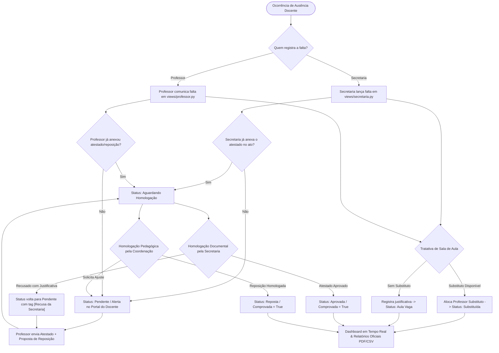

# 📋 Documento de Levantamento de Requisitos — Docente360

**Última atualização:** 18 de Novembro de 2026  
**Versão:** 2.0 (Sincronizado com a Arquitetura Implementada)

---

## 1. Visão Geral do Produto

### 1.1 Objetivo
O **Docente360** é uma plataforma web integrada para gestão operacional e pedagógica de ausências docentes, controle de substituições em sala de aula, submissão e homologação de atestados médicos, acompanhamento de reposições de aulas e monitoramento de indicadores acadêmicos. O sistema elimina controles manuais descentralizados (como planilhas físicas ou mensagens informais), garantindo transparência, rastreabilidade, integridade de dados e agilidade para a tomada de decisão da gestão escolar e participação ativa dos docentes.

### 1.2 Proposta de Valor
- **Centralização e Autoatendimento:** Ponto único para registro e consulta de ocorrências docentes, integrando Secretaria, Coordenação Acadêmica, Professores e Administração.
- **Eficiência Operacional:** Redução de pelo menos 50% do tempo gasto pela secretaria no controle diário de faltas, substituições e validação documental.
- **Previsibilidade Pedagógica:** Visibilidade imediata de turmas desassistidas ("Aulas Vagas") e monitoramento do cumprimento do calendário escolar via homologação de reposições.
- **Segurança e Conformidade:** Armazenamento seguro de documentos comprobatórios e atestados médicos em nuvem sob políticas de acesso autenticado (LGPD).

---

## 2. Perfis de Usuário e Autenticação (Supabase Auth Oficial)

O acesso ao sistema Docente360 contempla quatro perfis institucionais utilizando o serviço **Supabase Auth Oficial** sincronizado automaticamente via trigger SQL (`handle_new_user`) com a tabela relacional `usuarios`, garantindo controle de sessão e segregação de telas baseada em papéis (**RBAC**).

| Perfil de Usuário | Descrição e Responsabilidades | Tipo de Acesso (Supabase Auth) | Permissões Principais |
| :--- | :--- | :--- | :--- |
| **Secretaria** | Responsável pela operação diária de frequência, alocação de docentes em sala, triagem de atestados e cadastros base. | Login próprio com e-mail institucional e senha | • Registrar ausências em fluxo duplo: anexando atestado no ato ou gerando evento para o docente (RF01) • Alocar professores substitutos ou classificar aulas vagas (RF02) • Homologar (aprovar) ou recusar/devolver atestados médicos com justificativa e pré-visualização em tela (RF03) • Anexar comprovantes e acordos de reposição a qualquer ocorrência (RF03/RF04) • Gerenciar cadastros base de professores, disciplinas e turmas (RF07) |
| **Coordenador Acadêmico** | Responsável pela gestão pedagógica, qualidade do ensino e cumprimento da carga horária. | Login próprio com e-mail institucional e senha | • Visualizar dashboard de indicadores analíticos em tempo real (RF05) • Homologar ou recusar/solicitar ajuste em planos de reposição de aula (RF04 / RN03) • Filtrar ocorrências por tipo de relatório, período, docente, turma e status (RF06) • Exportar relatórios gerenciais oficiais em PDF diagramado (paisagem) e CSV (RF06) |
| **Professor** | Docente titular ou substituto com acesso ao Portal do Docente para autoatendimento. | Login próprio com vínculo automático ou assistido ao cadastro de `professores` | • Consultar indicadores pessoais e alertas de pendências ou recusas de atestado (RF08) • Enviar/reenviar atestados médicos e propor datas/horários de reposição (RF03/RF04) • Comunicar ausências programadas ou emergenciais via auto-registro (RF01/RF08) • Consultar escala de aulas em que foi alocado como substituto (RF02/RF08) |
| **Administrador** | Gestão técnica, governança institucional e supervisão global da plataforma. | Login master com e-mail institucional e senha | • Navegação Master na barra lateral permitindo operar e auditar todos os módulos (Secretaria, Coordenação, Portal do Professor e Painel Admin) • Consultar equipe de operadores cadastrados (`usuarios`), métricas globais e histórico geral • Gerenciar cadastros base (docentes, disciplinas e turmas) (RF07) |

---

## 3. Requisitos Funcionais (RF)

### 📌 Módulo 1: Operação, Frequência Diária e Cadastros Base

#### [RF01] Lançamento de Ausências (Fluxo Duplo da Secretaria & Auto-registro Docente)
- **Prioridade:** Essencial (Must Have)
- **Atores:** Secretaria, Professor
- **Descrição:** O sistema deve oferecer formulários ágeis para registro de ausências docentes tanto pela Secretaria quanto pelo próprio Professor (auto-registro).
- **Campos Obrigatórios:**
  - Professor ausente (selecionado pela Secretaria ou identificado automaticamente na sessão do Professor);
  - Disciplina e Turma afetada;
  - Data da ocorrência e Horário/Bloco da aula (`1º ao 4º Horário`);
  - Categoria do motivo (Saúde, Assuntos Pessoais, Compromisso Institucional/Congresso, Trânsito/Deslocamento, Outros) e observações adicionais.
- **Critérios de Aceite:**
  - **Fluxo Duplo na Secretaria:** A Secretaria pode escolher no ato do lançamento entre:
    1. *Criar evento para o professor anexar o atestado depois* (gera status `"Pendente"` e notifica o docente no Portal do Professor); ou
    2. *Anexar o atestado agora* (permite upload imediato do comprovante e registro opcional da reposição acordada, encaminhando direto para `"Aguardando Homologação"`).
  - **Auto-registro no Portal do Docente:** O professor pode comunicar uma ausência identificando matéria, turma, data, horário e motivo, podendo anexar opcionalmente o comprovante e a proposta de reposição no momento do aviso (`registrado_por = 'Docente'`).

#### [RF02] Gestão de Substituições, Candidatura Docente e Aulas Vagas
- **Prioridade:** Essencial (Must Have)
- **Atores:** Secretaria, Professor
- **Descrição:** Para cada ausência pendente de tratativa operacional, a cobertura da turma em sala de aula pode ser definida pela Secretaria ou por **autocandidatura de um professor substituto no Portal do Docente**.
- **Fluxos Disponíveis:**
  1. **Candidatura / Autoatribuição pelo Professor no Portal do Docente:** Qualquer professor disponível visualiza as ausências de outros docentes pendentes de substituição na aba `"🤝 Substituições"` do seu dashboard (com verificação automática de conflito na sua agenda) e pode se candidatar/assumir a aula com 1 clique (`candidatar_substituicao_docente`), ou liberar a substituição caso ocorra imprevisto (`cancelar_substituicao_docente`).
  2. **Alocação Direta pela Secretaria:** Seleção de um docente substituto disponível pela Secretaria, vinculando-o à ocorrência.
  3. **Classificação como "Aula Vaga":** Marcação formal pela Secretaria da impossibilidade de substituição imediata, registrando justificativa/observações para a turma.
- **Critérios de Aceite:**
  - O sistema impede que o professor titular ausente seja selecionado ou se candidate como seu próprio substituto e valida conflitos de horário no mesmo bloco (`verificar_conflito_substituto`).
  - O status da ausência é atualizado para `"Substituída"` (ou preserva o status de homologação de atestado, preenchendo `NomeSubstituto` imediatamente no Histórico da Secretaria e nas escalas).
  - O docente escalado ou voluntário visualiza suas aulas confirmadas na seção `"📋 Minhas Substituições Confirmadas"` do Portal do Docente.

#### [RF07] Gestão de Cadastros Base (Professores, Disciplinas e Turmas)
- **Prioridade:** Essencial (Must Have)
- **Atores:** Secretaria, Administrador
- **Descrição:** Interface dedicada para manutenção das entidades fundamentais da instituição sem necessidade de intervenção direta no banco de dados.
- **Critérios de Aceite:**
  - Cadastro de **Professores** (nome, e-mail institucional único e departamento), **Matérias/Disciplinas** (código único em maiúsculas e nome) e **Turmas** (código único, curso e turno/período).
  - Busca textual em tempo real para filtragem instantânea em todas as listagens.
  - Exclusão segura com tratamento de integridade referencial (impede exclusão caso o registro possua ausências ou substituições vinculadas, exibindo mensagem amigável ao operador).

---

### 📌 Módulo 2: Atestados, Homologação Documental e Reposições

#### [RF03] Controle, Pré-visualização e Homologação de Atestados
- **Prioridade:** Essencial (Must Have)
- **Atores:** Professor, Secretaria, Coordenador Acadêmico
- **Descrição:** Fluxo completo de upload, armazenamento em nuvem, visualização embutida e aprovação/recusa de documentos comprobatórios vinculados às ausências.
- **Critérios de Aceite:**
  - Suporte a formatos `.pdf`, `.png`, `.jpg`, `.jpeg` armazenados no bucket `atestados` do Supabase Storage com sanitização automática de nomes de arquivos (`sanitizar_nome_arquivo`, removendo acentos e caracteres especiais).
  - Ao anexar o documento, o status da ausência passa para `"Aguardando Homologação"`.
  - Na aba `"✅ Homologação"` da Secretaria, o operador conta com contador dinâmico de pendências, link direto e **pré-visualização embutida na tela** (renderização de imagens e `iframe` para PDFs).
  - Na aba `"📋 Histórico"` da Secretaria (e `"📋 Ocorrências"` do Administrador), a tabela apresenta de forma enxuta as 8 colunas operacionais (`Data`, `Horário`, `Professor`, `Motivo`, `Status`, `Atestado`, `NomeSubstituto`, `AulaVaga`), onde a coluna **Atestado** exibe um botão clicável **`📄 Ver Atestado`** e a seleção de qualquer linha abre o documento embutido na própria plataforma.
  - **Aprovação pela Secretaria:** Atualiza o status da ausência para `"Aprovada"` e marca `comprovada = True`.
  - **Recusa / Devolução ao Professor:** Caso o documento esteja ilegível ou inválido, a Secretaria informa uma justificativa obrigatória. O sistema anexa a tag `[Recusa da Secretaria: <motivo>]` à ocorrência, limpa o anexo inválido, retorna o status para `"Pendente"` e exibe um alerta em destaque no Portal do Docente para reenvio do comprovante corrigido.

#### [RF04] Planejamento e Homologação Pedagógica de Reposição de Aulas
- **Prioridade:** Essencial (Must Have)
- **Atores:** Professor, Secretaria, Coordenador Acadêmico
- **Descrição:** Fluxo para agendamento e validação pedagógica das aulas que precisam ser repostas para cumprimento do calendário acadêmico.
- **Critérios de Aceite:**
  - O professor (ou a secretaria) informa a data sugerida para reposição e o horário/local proposto.
  - O Coordenador Acadêmico analisa as solicitações na aba `"✅ Homologação"`, podendo consultar o motivo, os dados de reposição e o atestado anexo.
  - O Coordenador pode `"✅ Homologar Reposição"` (atualizando o status da ocorrência para `"Reposta"` e `comprovada = True`) ou `"❌ Recusar / Solicitar Ajuste"` (retornando o status para `"Pendente"`).

#### [RF08] Portal do Docente e Vínculo Inteligente de Contas
- **Prioridade:** Essencial (Must Have)
- **Atores:** Professor
- **Descrição:** Ambiente exclusivo para o corpo docente acompanhar sua situação funcional e interagir com a Secretaria e a Coordenação.
- **Critérios de Aceite:**
  - No cadastro de nova conta (`views/login.py`), o docente pode optar por vincular seu login a um registro de professor já cadastrado pela Secretaria ou criar um novo cadastro docente automaticamente.
  - Caso um usuário autenticado com perfil `"Professor"` ainda não possua `professor_id` vinculado, o sistema realiza o pareamento automático por e-mail ou oferece um seletor de vínculo rápido no primeiro acesso.
  - Painel superior com 4 KPIs pessoais (`Minhas Ausências`, `Pendentes de Atestado`, `Aguardando Homologação` e `Atestados Aprovados`) e alertas visuais para eventos lançados pela Secretaria ou atestados recusados.

---

### 📌 Módulo 3: Análise, Indicadores e Relatórios Gerenciais

#### [RF05] Dashboard de Indicadores em Tempo Real
- **Prioridade:** Essencial (Must Have)
- **Atores:** Coordenador Acadêmico, Administrador
- **Descrição:** Painel analítico e visual consolidando métricas operacionais e pedagógicas em tempo real.
- **Métricas e Gráficos:**
  - **5 KPIs Principais:** Total de Ausências; Substituições (com percentual da taxa de cobertura); Aulas Vagas; Aguardando Homologação; Aulas Repostas/Aprovadas.
  - **Gráfico 1 (Rosca / Donut Plotly):** Distribuição proporcional das ocorrências por Status com paleta semântica de cores.
  - **Gráfico 2 (Barras Empilhadas/Agrupadas Plotly):** Frequência de ausências por Docente segmentada por Status.

#### [RF06] Central de Emissão de Relatórios Gerenciais (PDF Paisagem & CSV)
- **Prioridade:** Essencial (Must Have)
- **Atores:** Coordenador Acadêmico, Administrador
- **Descrição:** Central avançada de filtros e extração sob demanda de relatórios executivos em PDF prontos para impressão/assinatura e planilhas CSV.
- **Critérios de Aceite:**
  - **Filtros Reativos Combinados:** Seleção de Tipo de Relatório (*Consolidado Geral*, *Aulas Vagas & Pendências*, *Reposições Homologadas*, *Individual por Docente*), Período Temporal (*Todo o Histórico*, *Mês Atual*, *Últimos 30 Dias*, *Intervalo Personalizado*), Docente, Turma e Status Operacional.
  - **Pré-visualização em Tela:** Exibição de 4 métricas-resumo do recorte filtrado e tabela interativa antes do download.
  - **PDF Oficial Diagramado em Paisagem (`ReportLab`):** Cabeçalho institucional com metadados de filtros e emissor, quadro de 5 KPIs coloridos, tabela analítica de 8 colunas, bloco duplo de assinaturas (*Coordenação Acadêmica* e *Secretaria Geral*) e rodapé com numeração dinâmica de páginas (`Página X de Y` via `NumberedCanvas`).
  - **Exportação Tabular:** Botão para download imediato dos dados filtrados em formato `.csv` (UTF-8).

---

## 4. Regras de Negócio (RN)

| Código | Nome da Regra | Descrição |
| :--- | :--- | :--- |
| **RN01** | **Restrição e Conflito de Substituto** | O docente titular ausente nunca pode ser alocado como substituto de sua própria aula, e o sistema valida automaticamente se o substituto selecionado já possui ausência ou outra substituição alocada na mesma data e bloco de horário (`verificar_conflito_substituto`), além de impedir registros duplicados de falta para o mesmo docente no mesmo horário (`verificar_conflito_ausencia`). |
| **RN02** | **Prazo de Envio de Atestado** | Atestados médicos devem ser submetidos preferencialmente em até 48 horas úteis (2 dias úteis) após a ausência (`calcular_prazo_atestado`), mantendo a ocorrência sinalizada como pendente de atestado enquanto não regularizada. |
| **RN03** | **Dupla Homologação (Documental e Pedagógica)** | Atestados submetidos entram em status `"Aguardando Homologação"`: a **Secretaria** valida a conformidade documental do atestado (aprovando para `"Aprovada"` ou recusando com justificativa obrigatória que devolve a pendência ao professor), enquanto a **Coordenação Acadêmica** homologa o cumprimento pedagógico do plano de reposição (`"Reposta"`). |
| **RN04** | **Classificação e Alerta de Pendências** | Toda ausência sem substituto ou sem atestado é destacada prioritariamente nas abas operacionais da Secretaria e no Portal do Docente até sua completa resolução. |
| **RN05** | **Sigilo de Dados Sensíveis (LGPD)** | Comprovantes médicos são armazenados no bucket `atestados` e seus links diretos não são expostos nos relatórios gerenciais em PDF/CSV nem nos gráficos públicos, ficando restritos às telas de anexo e homologação. |
| **RN06** | **Proteção de Integridade Referencial** | Professores, disciplinas e turmas que possuam histórico de ausências ou substituições não podem ser excluídos acidentalmente pelos operadores, preservando a auditoria histórica. |
| **RN07** | **Sincronização e Vínculo Automático de Perfil** | Novos usuários criados no Supabase Auth são sincronizados via trigger `on_auth_user_created` na tabela `usuarios`, vinculando automaticamente o `professor_id` caso o e-mail institucional corresponda a um docente pré-cadastrado. |

---

## 5. Requisitos Não Funcionais (RNF)

| Código | Categoria | Descrição |
| :--- | :--- | :--- |
| **RNF01** | **Usabilidade e Frontend** | Interface desenvolvida em **Streamlit** com design system customizado em CSS (`components/styles.py`), navegação em abas estilo *pills* sem corte de texto, badges semânticos por perfil e layout fluido (`wide`). |
| **RNF02** | **Banco de Dados e Persistência** | Utilização do **Supabase (PostgreSQL 15+)** como backend relacional com chaves estrangeiras, constraints de unicidade, triggers em `PL/pgSQL` e Row Level Security (RLS). |
| **RNF03** | **Armazenamento de Arquivos** | Armazenamento de comprovantes via **Supabase Storage** (bucket `atestados`) com tratamento de MIME types, *upsert* seguro e sanitização ASCII de nomes de arquivos. |
| **RNF04** | **Eficiência e Produtividade** | Fluxo de lançamento de ausências e definição de substituição otimizado para conclusão em menos de 60 segundos por ocorrência, com recarregamento reativo via `st.rerun()`. |
| **RNF05** | **Desempenho** | Conexão com cliente Supabase em cache (`@st.cache_resource`), joins relacionais consolidados em consulta única (`get_ausencias_completas`) e geração de PDF em memória (`BytesIO`). |
| **RNF06** | **Segurança e Autenticação** | Controle de autenticação e sessão com **Supabase Auth**, senhas criptografadas e roteamento estrito por perfil (`app.py`), além de modo de inspeção multi-setor exclusivo para o perfil Administrador. |

---

## 6. Fluxo Geral do Processo (Visão Operacional Completa)

---

## 7. Arquitetura Implementada e Evolução Contínua

1. **Modelagem de Dados Relacional (`banco_dados.sql`):**
   - 7 tabelas implementadas e ativas: `professores`, `disciplinas`, `turmas`, `ausencias`, `substituicoes`, `reposicoes_atestados` e `usuarios` (sincronizada com `auth.users`).
2. **Armazenamento e Políticas de Segurança:**
   - Bucket `atestados` configurado no Supabase Storage com políticas de leitura/escrita para usuários autenticados e RLS ativo em todas as tabelas.
3. **Arquitetura Modular em Camadas:**
   - Ponto de entrada enxuto em [`app.py`](file:///d:/Projects/docente360/app.py), camada de serviços em `services/`, telas por perfil em `views/`, componentes reutilizáveis em `components/` e motor de relatórios PDF em `utils/pdf_generator.py`.
4. **Evoluções Futuras (Backlog de Refinamento):**
   - Checagem automática de choque de horário entre múltiplas turmas para o professor substituto (RN01 avançada).
   - Badge visual automático de atraso para ausências com mais de 48h úteis sem atestado (RN02).
   - Seletores de filtro temporal diretamente na aba de gráficos do Dashboard da Coordenação.