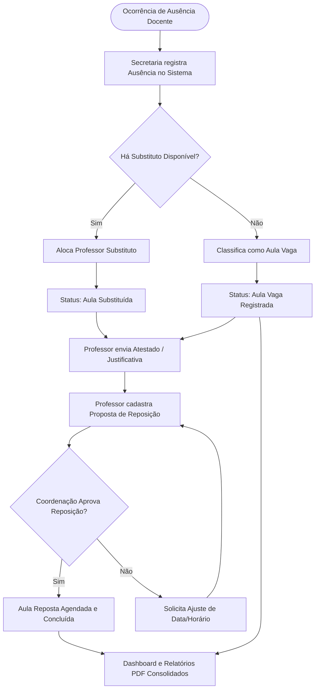

# 📋 Documento de Levantamento de Requisitos — Docente360

---

## 1. Visão Geral do Produto

### 1.1 Objetivo
O **Docente360** é uma plataforma integrada para gestão operacional e pedagógica de ausências docentes, controle de substituições, acompanhamento de reposições de aulas e monitoramento de indicadores acadêmicos. O sistema visa eliminar controles manuais descentralizados (como planilhas físicas ou mensagens informais), garantindo transparência, integridade de dados e agilidade para a tomada de decisão da gestão escolar.

### 1.2 Proposta de Valor
- **Centralização:** Ponto único para registro e consulta de ocorrências docentes.
- **Eficiência Operacional:** Redução de pelo menos 50% do tempo gasto pela secretaria no controle diário de faltas e substituições.
- **Previsibilidade Pedagógica:** Visibilidade imediata de turmas desassistidas ("Aulas Vagas") e monitoramento do cumprimento do calendário escolar via reposições.
- **Segurança e Conformidade:** Armazenamento seguro de documentos comprobatórios e atestados médicos sob políticas rígidas de acesso (LGPD).

---

## 2. Perfis de Usuário e Matriz de Acesso (RBAC)

| Perfil | Descrição e Responsabilidades | Permissões Principais |
| :--- | :--- | :--- |
| **Secretaria** | Responsável pela operação diária de frequência e alocação de docentes em sala. | • Registrar ausências em tempo real • Alocar professores substitutos • Classificar aulas vagas • Pré-cadastrar justificativas informadas |
| **Professor** | Docente da instituição com aulas atribuídas na grade. | • Consultar suas faltas registradas • Fazer upload de atestados médicos/declarações • Propor e acompanhar datas/horários para reposição de aulas |
| **Coordenador Acadêmico** | Responsável pela gestão pedagógica, qualidade do ensino e cumprimento da carga horária. | • Visualizar dashboard de indicadores analíticos • Filtrar ausências por turma, docente e disciplina • Homologar planos de reposição de aula • Exportar relatórios gerenciais em PDF |
| **Administrador (Opcional/Técnico)** | Responsável pela parametrização inicial e suporte ao sistema. | • Gestão de usuários e permissões • Cadastro/importação de turmas, docentes e disciplinas |

---

## 3. Requisitos Funcionais (RF)

### 📌 Módulo 1: Operação e Frequência Diária

#### [RF01] Lançamento Diário de Ausências
- **Prioridade:** Essencial (Must Have)
- **Atores:** Secretaria
- **Descrição:** O sistema deve fornecer um formulário ágil para registro da ausência docente.
- **Campos Obrigatórios:**
  - Professor ausente;
  - Data da ocorrência;
  - Turma(s) afetada(s);
  - Disciplina(s);
  - Turno e bloco/horário da aula (ex: 1º e 2º horário matutino);
  - Motivo preliminar da ausência (ex: Saúde, Particular, Compromisso Institucional, Não Informado).
- **Critérios de Aceite:**
  - O sistema deve validar conflito de horário para evitar registros duplicados para o mesmo docente no mesmo bloco.
  - Ao salvar, a ocorrência gera status inicial `"Pendente de Substituição"` ou `"Pendente de Justificativa"`.

#### [RF02] Gestão de Substituições e Aulas Vagas
- **Prioridade:** Essencial (Must Have)
- **Atores:** Secretaria
- **Descrição:** Para cada ausência registrada, a secretaria deve definir a tratativa operacional imediata.
- **Fluxos Disponíveis:**
  1. **Alocação de Substituto:** Seleção de um docente substituto disponível para o horário, vinculando-o à turma.
  2. **Classificação como "Aula Vaga":** Marcação formal da impossibilidade de substituição imediata, registrando observações para a equipe de apoio aos alunos.
- **Critérios de Aceite:**
  - O sistema não deve permitir alocar um substituto que já esteja com aula ativa no mesmo horário/dia.
  - O status da aula é atualizado instantaneamente para `"Substituída"` ou `"Aula Vaga"`.

---

### 📌 Módulo 2: Justificativas, Atestados e Reposições

#### [RF03] Controle de Atestados e Comprovações
- **Prioridade:** Essencial (Must Have)
- **Atores:** Professor, Secretaria
- **Descrição:** Permitir envio e anexação de documentos comprobatórios (atestados médicos, convocações judiciais, certidões) vinculados a uma ou mais ausências registradas.
- **Critérios de Aceite:**
  - Suporte a formatos `.pdf`, `.png`, `.jpg`, `.jpeg` com limite máximo configurável (ex: até 10MB por arquivo).
  - O documento deve ser armazenado em bucket seguro com controle de visibilidade (apenas o professor proprietário, a secretaria e a coordenação podem visualizar).
  - Atualização do status da ausência para `"Justificada"` ou `"Aguardando Validação"`.

#### [RF04] Planejamento e Acompanhamento de Reposição de Aulas
- **Prioridade:** Importante (Should Have)
- **Atores:** Professor, Coordenador Acadêmico, Secretaria
- **Descrição:** Fluxo para agendamento, validação e baixa de aulas que precisam ser repostas para cumprimento do calendário acadêmico.
- **Critérios de Aceite:**
  - O professor propõe: data da reposição, horário, sala e plano de conteúdo.
  - O coordenador acadêmico pode `"Aprovar"`, `"Solicitar Ajuste"` ou `"Recusar"` a proposta.
  - Após a execução da reposição, a secretaria ou o professor registra a confirmação, marcando a reposição como `"Concluída"`.

---

### 📌 Módulo 3: Análise, Indicadores e Relatórios

#### [RF05] Dashboard de Indicadores em Tempo Real
- **Prioridade:** Essencial (Must Have)
- **Atores:** Coordenador Acadêmico, Secretaria
- **Descrição:** Painel analítico e visual consolidando métricas operacionais e pedagógicas com filtros por período (dia, semana, mês, semestre), turma e disciplina.
- **Métricas e Gráficos:**
  - **KPIs:** Total de ausências no período; Taxa de substituição (%); Total acumulado de aulas vagas; Taxa de reposições pendentes.
  - **Gráfico 1:** Ausências por turma e curso (identificação de turmas críticas).
  - **Gráfico 2:** Frequência de ausências por dia da semana / turno.
  - **Gráfico 3:** Distribuição por motivo (Saúde, Licença, etc.).

#### [RF06] Exportação de Relatórios Gerenciais em PDF
- **Prioridade:** Essencial (Must Have)
- **Atores:** Coordenador Acadêmico, Secretaria
- **Descrição:** Geração sob demanda de relatórios consolidados em formato PDF prontos para impressão ou compartilhamento em reuniões pedagógicas e conselhos de classe.
- **Critérios de Aceite:**
  - Layout formal contendo cabeçalho institucional, filtros aplicados, data e hora de extração.
  - Tabelas detalhadas de ocorrências, histórico de substituições e pendências de reposição.
  - Opção adicional de exportação em planilha (`.csv` ou `.xlsx`) para conferência contábil/administrativa.

---

## 4. Regras de Negócio (RN)

| Código | Nome da Regra | Descrição |
| :--- | :--- | :--- |
| **RN01** | **Conflito de Horário do Substituto** | Um docente não pode ser alocado como substituto caso possua outra aula regular ou substituição confirmada no mesmo dia e bloco de horários. |
| **RN02** | **Prazo de Envio de Atestado** | Atestados médicos devem ser submetidos preferencialmente em até 48 horas úteis após a ausência, sinalizando pendência caso ultrapasse o período. |
| **RN03** | **Homologação Obrigatória de Reposição** | Toda reposição de aula só é considerada válida no cômputo da carga horária após homologação explícita da Coordenação Acadêmica. |
| **RN04** | **Classificação Automática de Pendência** | Toda ausência sem registro de substituto até o horário de início da aula deve ser destacada visualmente para a secretaria como alerta de aula vaga iminente. |
| **RN05** | **Sigilo de Dados Sensíveis (LGPD)** | Dados e anexos médicos (atestados) devem ter restrição de acesso e não podem ser exibidos no dashboard público nem em relatórios gerais. |

---

## 5. Requisitos Não Funcionais (RNF)

| Código | Categoria | Descrição |
| :--- | :--- | :--- |
| **RNF01** | **Usabilidade e Frontend** | A interface de usuário deve ser desenvolvida em **Streamlit**, apresentando navegação fluida, layout intuitivo e responsividade para telas de desktop, tablets e smartphones. |
| **RNF02** | **Banco de Dados e Persistência** | Utilização do **Supabase** como backend: banco relacional **PostgreSQL** para transações íntegras e relacionamentos entre turmas, docentes e ausências. |
| **RNF03** | **Armazenamento de Arquivos** | Armazenamento de comprovantes via **Supabase Storage (Bucket seguro)**, aplicando políticas de segurança por linha (Row Level Security - RLS) para garantir acesso exclusivo a usuários autorizados. |
| **RNF04** | **Eficiência e Produtividade** | O fluxo de lançamento de ausências e definição de substituição deve ser otimizado para ser concluído em menos de 60 segundos por ocorrência, atingindo a meta de **redução comprovada de no mínimo 50% do tempo gasto em registros manuais**. |
| **RNF05** | **Desempenho** | O carregamento dos dashboards e a emissão de relatórios em PDF para períodos de até 6 meses não devem exceder 3 segundos sob condições normais de rede. |
| **RNF06** | **Segurança e Autenticação** | Controle de autenticação e sessão com **Supabase Auth**, com senhas criptografadas e segregação de telas com base no perfil de acesso autenticado. |

---

## 6. Fluxo Geral do Processo (Visão Operacional)

---

## 7. Próximos Passos Recomendados

1. **Modelagem de Dados Relacional (Supabase):**
   - Criação das tabelas: `perfis`, `professores`, `turmas`, `disciplinas`, `grades_horarias`, `ausencias`, `substituicoes`, `atestados`, `reposicoes`.
2. **Configuração de Buckets e Políticas RLS:**
   - Bucket `comprovantes-atestados` com políticas restritivas por `auth.uid()`.
3. **Prototipação da Interface (Streamlit):**
   - Criação da barra lateral com controle de acesso dinâmico por perfil.
   - Telas modulares em `pages/`: Lançamento Rápido, Atestados & Reposições, Dashboard e Relatórios.